# Manajemen Sekolah

Aplikasi pengelolaan data pengguna dan siswa menggunakan Flutter, Next.js, dan MySQL.

Aplikasi dapat dijalankan melalui browser dan dipasang pada perangkat Android dalam bentuk APK. Frontend Flutter dan backend Next.js disimpan dalam satu repository.

## Tim Pengembang

- Felicya Agatha Susanto Lie
- Ramadhan Agil Siraj

## Teknologi

| Bagian | Teknologi |
|---|---|
| Frontend | Flutter dan Dart |
| Backend | Next.js App Router dan TypeScript |
| Database | MySQL |
| Komunikasi API | HTTP |
| Hash password | bcryptjs |
| Token autentikasi | JWT menggunakan jose |
| Penyimpanan nama pengguna | Shared Preferences |
| Pengujian API | Postman |
| Editor | Visual Studio Code |

## Fitur

### Login dan Logout

- Login menggunakan email dan password.
- Login hanya untuk akun berstatus Aktif.
- Tombol tampilkan dan sembunyikan password.
- Pesan berhasil atau gagal login.
- Token login berlaku selama 8 jam.
- Logout kembali ke halaman login.

### Dashboard

- Sapaan sesuai nama akun yang login.
- Menu Data Pengguna.
- Menu Data Siswa.
- Tampilan menyesuaikan lebar layar.

### Data Pengguna

- Menampilkan daftar pengguna.
- Pencarian berdasarkan nama atau email.
- Filter status Aktif dan Tidak Aktif.
- Form tambah muncul setelah tombol Tambah Pengguna diklik.
- Edit nama, email, password, dan status.
- Password lama dipertahankan jika kolom password saat edit dikosongkan.
- Hapus pengguna dengan konfirmasi.
- Akun yang sedang digunakan tidak dapat dihapus atau dinonaktifkan.

### Data Siswa

- Menampilkan daftar siswa.
- Pencarian berdasarkan nama atau NIPD.
- Filter kelas.
- Form tambah muncul setelah tombol Tambah Siswa diklik.
- Edit data siswa.
- Hapus siswa dengan konfirmasi.
- Dropdown kelas dan jurusan.

### Pilihan Kelas

- X
- XI
- XII

### Pilihan Jurusan

- Rekayasa Perangkat Lunak
- Teknik Komputer dan Jaringan
- Desain Komunikasi Visual
- Bisnis Digital
- Tax Accounting

## Struktur Proyek

| Lokasi | Fungsi |
|---|---|
| `lib/main.dart` | Titik awal aplikasi Flutter |
| `lib/page_login.dart` | Halaman login |
| `lib/page_dashboard.dart` | Dashboard utama |
| `lib/page_manajemen_data.dart` | Daftar data, form, pencarian, filter, dan aksi CRUD |
| `lib/services/user_service.dart` | Komunikasi Flutter dengan API |
| `android/` | Konfigurasi aplikasi Android |
| `web/` | Konfigurasi Flutter web |
| `docs/aplikasi/` | Screenshot tampilan aplikasi |
| `backend-siswa/app/api/` | Endpoint API Next.js |
| `backend-siswa/lib/database.ts` | Koneksi MySQL |
| `backend-siswa/lib/pengguna_api.ts` | Pemeriksaan token dan validasi pengguna |
| `backend-siswa/database/` | Berkas SQL |
| `backend-siswa/postman/` | Collection Postman |
| `backend-siswa/docs/postman/` | Screenshot pengujian API |

## Persyaratan

Siapkan:

1. Git.
2. Flutter SDK.
3. Chrome untuk menjalankan aplikasi web.
4. Node.js dan npm yang kompatibel dengan versi Next.js proyek.
5. MySQL, misalnya melalui Laragon.
6. Android SDK jika ingin membuat APK.
7. Postman untuk pengujian API.

Periksa lingkungan Flutter:

```bash
flutter doctor
```

## Instalasi

### 1. Clone Repository

```bash
git clone https://github.com/FelicyaAgatha/FlutterEnd.git
cd FlutterEnd
```

Nama folder lokal boleh berbeda. Jalankan perintah Flutter dari folder yang memiliki file `pubspec.yaml`.

### 2. Install Dependensi Flutter

Dari folder utama proyek:

```bash
flutter pub get
```

### 3. Install Dependensi Backend

```powershell
cd backend-siswa
npm.cmd install
```

### 4. Siapkan Database

Jalankan MySQL melalui Laragon.

Database default:

```text
db_toko
```

Tabel yang dibutuhkan:

| Tabel | Kolom |
|---|---|
| `users` | `id`, `nama`, `email`, `password`, `created_at`, `status` |
| `siswa` | `id`, `nipd`, `nama_lengkap`, `jenis_kelamin`, `alamat`, `kelas`, `jurusan` |

Gunakan berkas SQL yang tersedia pada folder:

```text
backend-siswa/database/
```

Jika berkas SQL hanya menyediakan tabel `siswa`, struktur tabel `users` dan akun pengelola perlu disiapkan secara terpisah.

Password pada tabel `users` harus berupa hash bcrypt. Akun yang digunakan untuk login harus berstatus Aktif.

Install dependensi tidak otomatis membuat database atau akun pengguna.

### 5. Atur Environment Backend

Dari folder `backend-siswa`, salin konfigurasi contoh:

```powershell
Copy-Item .env.example .env.local
```

Sesuaikan isi `.env.local`:

```dotenv
DB_HOST=localhost
DB_PORT=3306
DB_USER=root
DB_PASSWORD=
DB_NAME=db_toko
JWT_SECRET=
```

Buat nilai acak untuk `JWT_SECRET`:

```powershell
node -e "console.log(require('crypto').randomBytes(32).toString('hex'))"
```

Tempel hasil perintah tersebut sebagai nilai `JWT_SECRET`.

Sesuaikan host, port, username, dan password MySQL dengan komputer masing-masing.

File `.env.local` tidak boleh diunggah ke repository.

## Menjalankan Aplikasi di Chrome

Gunakan dua terminal terpisah.

### Terminal 1 — Backend

Dari folder utama proyek:

```powershell
cd backend-siswa
npm.cmd run dev -- --port 3001
```

Backend berjalan di:

```text
http://localhost:3001
```

### Terminal 2 — Flutter

Dari folder utama proyek yang memiliki `pubspec.yaml`:

```bash
flutter run -d chrome
```

Biarkan MySQL serta kedua terminal tetap berjalan selama aplikasi digunakan.

Login menggunakan email dan password akun Aktif pada tabel `users`.

## Konfigurasi Alamat API

Pada `lib/services/user_service.dart`:

```dart
static const String baseUrl = String.fromEnvironment(
  'API_BASE_URL',
  defaultValue: 'http://localhost:3001',
);
```

Alamat API dapat diganti saat menjalankan atau membangun aplikasi.

Contoh:

```bash
flutter run -d chrome --dart-define=API_BASE_URL=http://localhost:3001
```

## Membuka Versi Web di HP

HP dan laptop harus berada pada jaringan yang sama.

### 1. Cari IP Laptop

Di Windows:

```powershell
ipconfig
```

Gunakan IPv4 Address pada adapter Wi-Fi yang aktif.

### 2. Jalankan Backend

Dari folder `backend-siswa`:

```powershell
npm.cmd run dev -- --hostname 0.0.0.0 --port 3001
```

### 3. Jalankan Flutter Web Server

Dari folder utama Flutter, ganti `IP_LAPTOP` dengan IPv4 laptop:

```bash
flutter run -d web-server --web-hostname 0.0.0.0 --web-port 8080 --dart-define=API_BASE_URL=http://IP_LAPTOP:3001
```

### 4. Buka Browser HP

Masukkan alamat:

```text
http://IP_LAPTOP:8080
```

## Membuat dan Memasang APK

Pastikan Android SDK tersedia.

Dari folder utama Flutter:

```bash
flutter build apk --release --dart-define=API_BASE_URL=http://IP_LAPTOP:3001
```

Ganti `IP_LAPTOP` dengan IP laptop yang menjalankan backend.

APK tersedia di:

```text
build/app/outputs/flutter-apk/app-release.apk
```

Langkah pemasangan:

1. Pindahkan APK ke HP Android.
2. Buka file APK melalui File Manager.
3. Izinkan pemasangan dari sumber tersebut jika diminta.
4. Pilih Install.
5. Buka aplikasi Manajemen Sekolah.

### Catatan Penggunaan APK

- APK saat ini terhubung ke backend lokal.
- MySQL dan backend pada laptop harus tetap berjalan.
- HP dan laptop harus berada pada jaringan yang sama.
- Flutter web server tidak diperlukan saat menggunakan APK.
- Jika IP backend berubah, build ulang APK dengan alamat baru.
- Izin internet dan akses HTTP lokal diatur melalui AndroidManifest.xml.
- Untuk penggunaan tanpa laptop menyala, backend dan database perlu di-hosting.

## Cara Menggunakan Aplikasi

### Login

1. Masukkan email akun.
2. Masukkan password asli akun, bukan hash dari database.
3. Klik Masuk.
4. Setelah berhasil, aplikasi membuka dashboard.

### Mengelola Pengguna

1. Pilih Data Pengguna pada dashboard.
2. Gunakan kolom pencarian untuk mencari nama atau email.
3. Pilih filter status jika diperlukan.
4. Klik Tambah Pengguna untuk membuka form.
5. Isi data dan klik Simpan.
6. Klik ikon Edit untuk memperbarui data.
7. Klik ikon Hapus dan konfirmasi untuk menghapus data.

### Mengelola Siswa

1. Pilih Data Siswa pada dashboard.
2. Gunakan pencarian berdasarkan nama atau NIPD.
3. Pilih filter kelas jika diperlukan.
4. Klik Tambah Siswa untuk membuka form.
5. Isi NIPD, nama, jenis kelamin, alamat, kelas, dan jurusan.
6. Klik Simpan.
7. Gunakan ikon Edit atau Hapus pada data yang dipilih.

### Logout

1. Klik ikon Keluar pada dashboard.
2. Pilih Keluar pada dialog konfirmasi.
3. Aplikasi kembali ke halaman login.

## Dokumentasi Tampilan Aplikasi

Screenshot disimpan dalam folder `docs/aplikasi/`.

### 1. Login

Halaman untuk masuk menggunakan email dan password akun aktif.

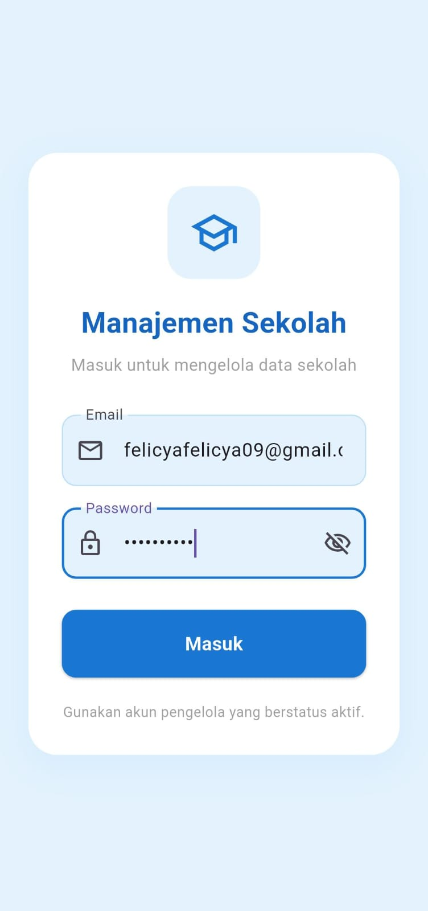

### 2. Dashboard

Halaman utama yang menampilkan nama pengguna serta menu Data Pengguna dan Data Siswa.

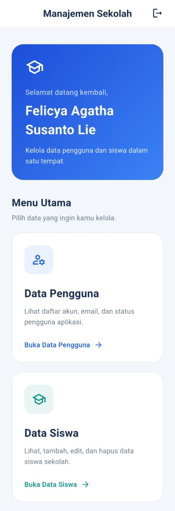

### 3. Data Pengguna

Daftar pengguna dengan pencarian, filter status, tombol tambah, serta aksi edit dan hapus.

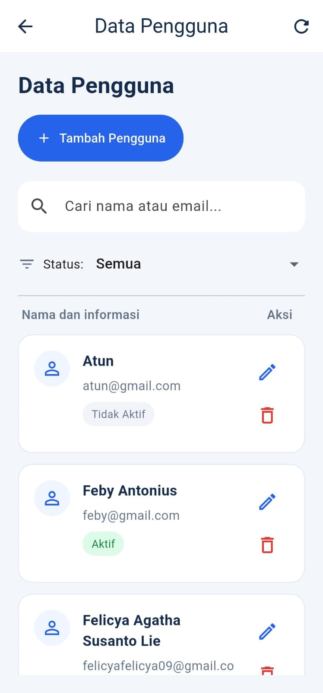

### 4. Tambah Pengguna

Form untuk menambahkan nama, email, password, dan status pengguna.

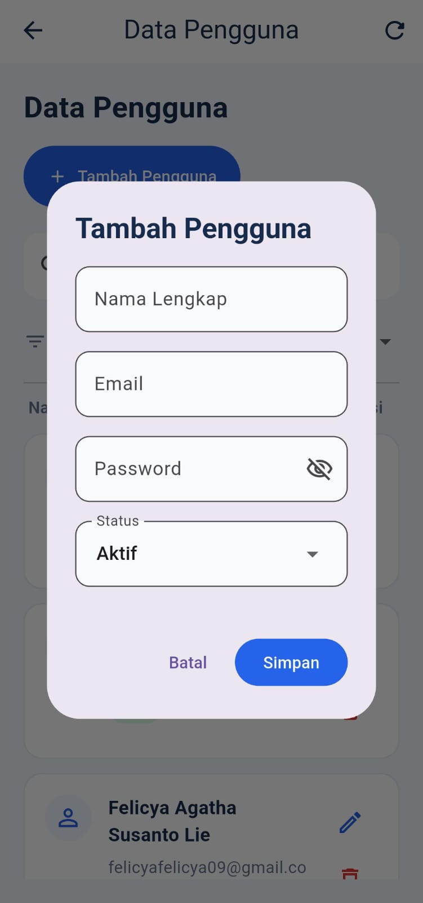

### 5. Edit Pengguna

Form untuk memperbarui informasi pengguna. Password dapat dikosongkan jika tidak ingin diubah.

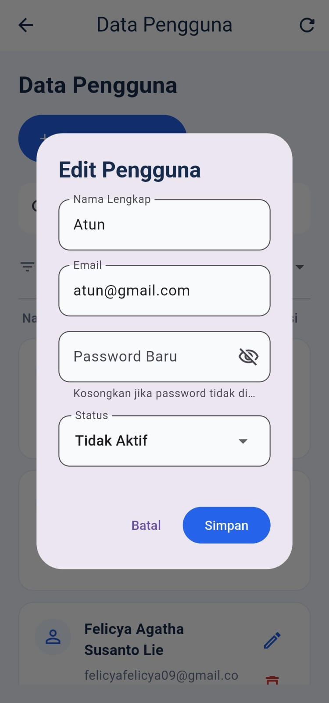

### 6. Hapus Pengguna

Dialog konfirmasi sebelum menghapus pengguna yang dipilih.

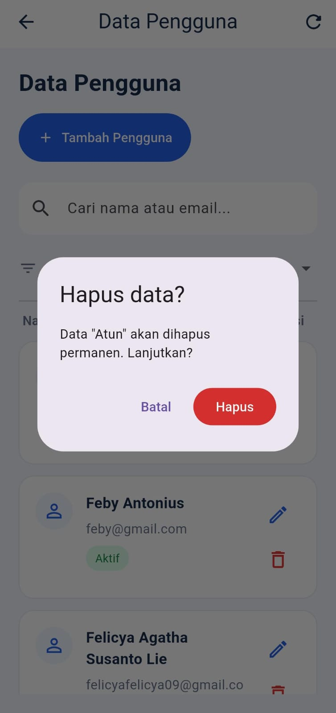

### 7. Data Siswa

Daftar siswa dengan pencarian, filter kelas, tombol tambah, serta aksi edit dan hapus.

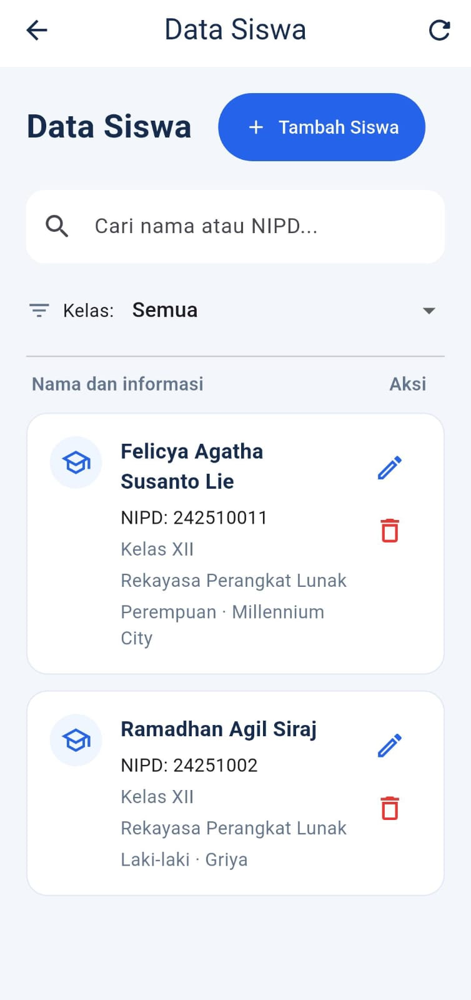

### 8. Tambah Siswa

Form untuk menambahkan data siswa dengan dropdown kelas dan jurusan.

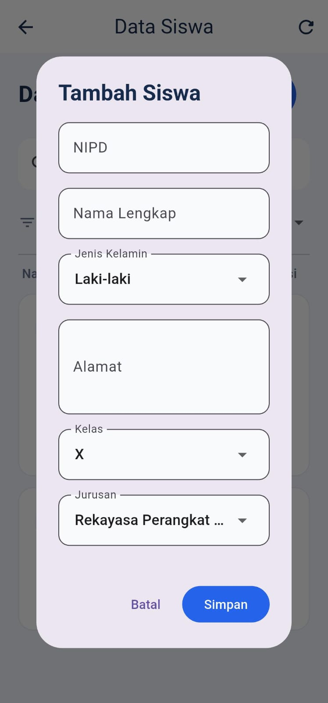

### 9. Edit Siswa

Form untuk memperbarui data siswa yang dipilih.

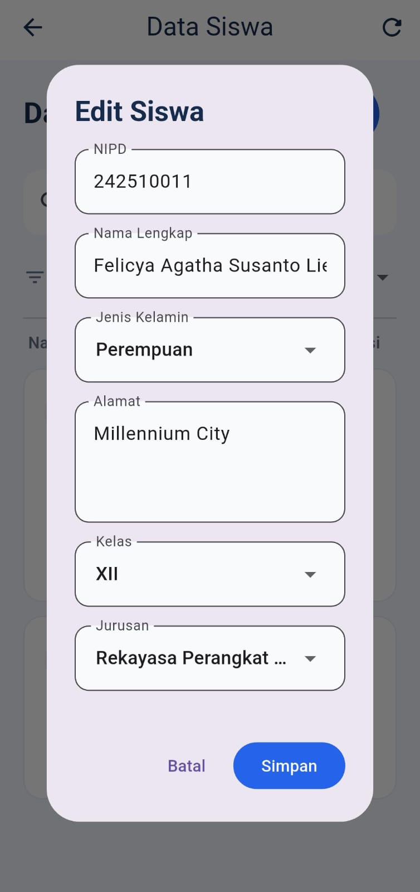

### 10. Hapus Siswa

Dialog konfirmasi sebelum menghapus siswa yang dipilih.

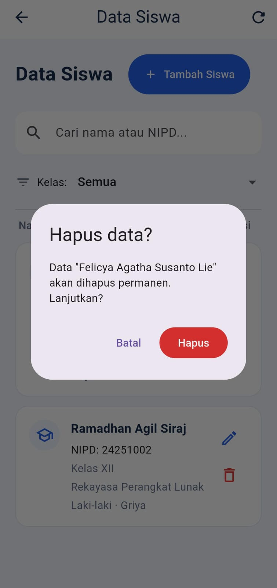

### 11. Logout

Dialog konfirmasi untuk keluar dari aplikasi dan kembali ke halaman login.

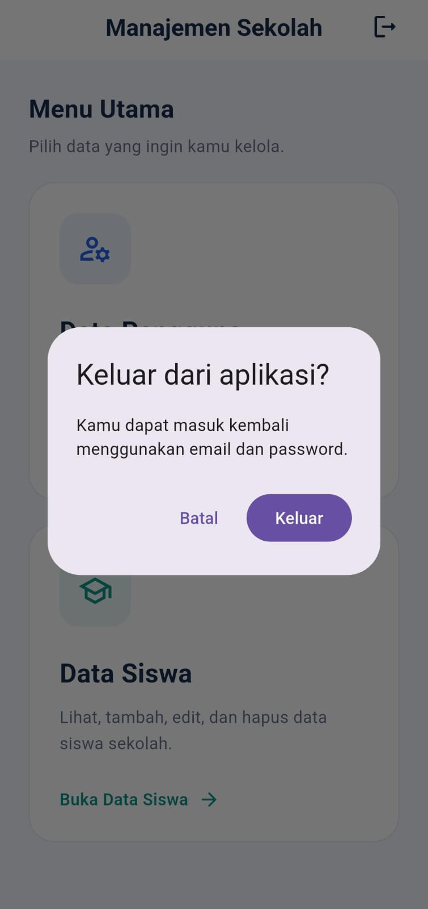

## Dokumentasi API

Base URL lokal:

```text
http://localhost:3001
```

| Method | Endpoint | Fungsi |
|---|---|---|
| POST | `/api/login` | Login pengguna |
| GET | `/api/users` | Menampilkan pengguna |
| POST | `/api/users` | Menambahkan pengguna |
| PUT | `/api/users/{id}` | Memperbarui pengguna |
| DELETE | `/api/users/{id}` | Menghapus pengguna |
| GET | `/api/siswa` | Menampilkan seluruh siswa |
| GET | `/api/siswa/{id}` | Menampilkan detail siswa |
| POST | `/api/siswa` | Menambahkan siswa |
| PUT | `/api/siswa/{id}` | Memperbarui siswa |
| DELETE | `/api/siswa/{id}` | Menghapus siswa |

Ganti `{id}` dengan ID data yang tersedia.

### Contoh Login

**POST** `/api/login`

```json
{
  "email": "email_akun_anda",
  "password": "password_akun_anda"
}
```

Token login tersedia pada `data.token`.

### Autentikasi API Pengguna

Endpoint pengguna membutuhkan header:

```text
Authorization: Bearer TOKEN_LOGIN
```

Di Postman, pilih **Authorization → Bearer Token**, lalu masukkan token hasil login.

### Contoh Input Pengguna

```json
{
  "nama": "Pengelola Sekolah",
  "email": "pengelola@example.com",
  "password": "GantiDenganPasswordAnda",
  "status": "Aktif"
}
```

Saat edit, password boleh dikosongkan untuk mempertahankan password lama.

### Contoh Input Siswa

```json
{
  "nipd": "24251002",
  "nama_lengkap": "Siswa Contoh",
  "jenis_kelamin": "Perempuan",
  "alamat": "Parungpanjang",
  "kelas": "XII",
  "jurusan": "Rekayasa Perangkat Lunak"
}
```

### Format Respons Berhasil

```json
{
  "status": true,
  "message": "Data siswa berhasil diambil",
  "data": []
}
```

### Format Respons Gagal

```json
{
  "status": false,
  "message": "Silakan login terlebih dahulu."
}
```

Pencarian dan filter pada daftar dilakukan di aplikasi Flutter. Endpoint daftar mengembalikan seluruh data.

## Collection Postman

Collection pengujian siswa:

[APISiswa.postman_collection.json](backend-siswa/postman/APISiswa.postman_collection.json)

Import melalui tombol **Import** pada Postman.

Sesuaikan alamat API serta ID data dengan lingkungan pengujian. Ekspor ulang collection apabila request baru belum disertakan.

## Dokumentasi Pengujian API Siswa

### GET — Seluruh Siswa

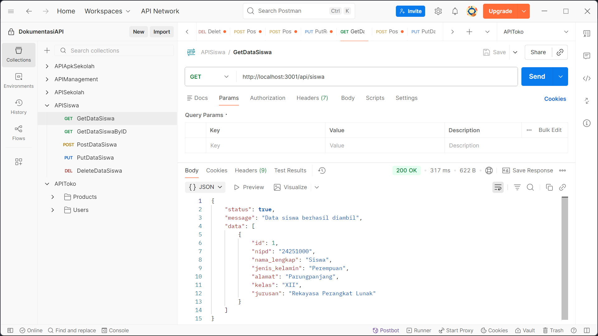

### GET — Siswa Berdasarkan ID

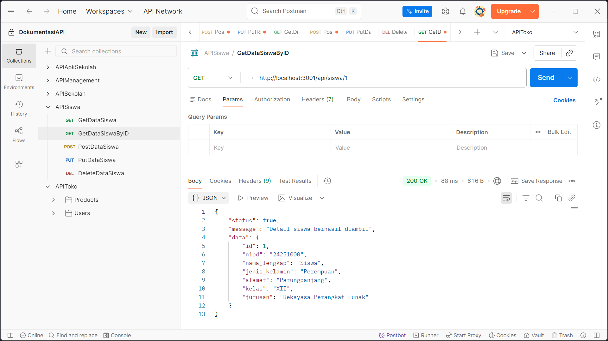

### POST — Tambah Siswa

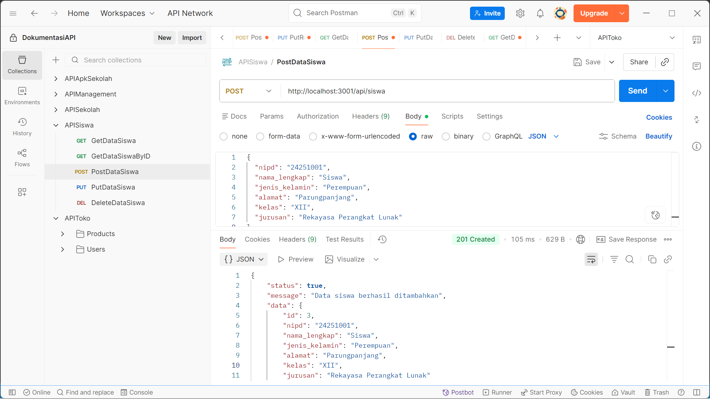

### PUT — Edit Siswa

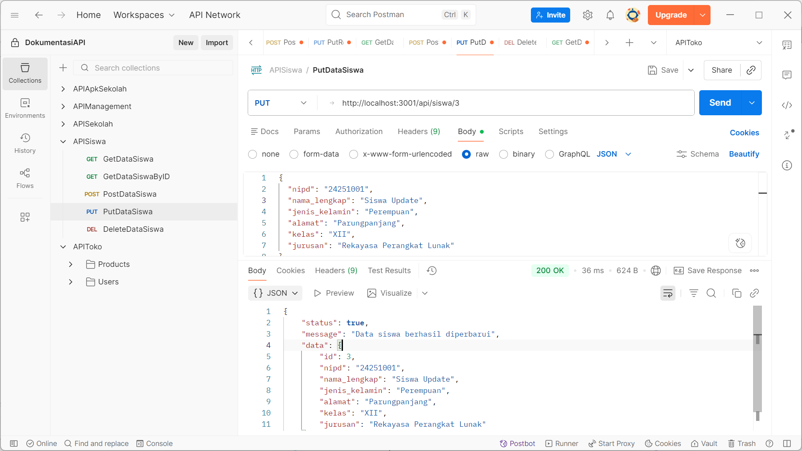

### DELETE — Hapus Siswa

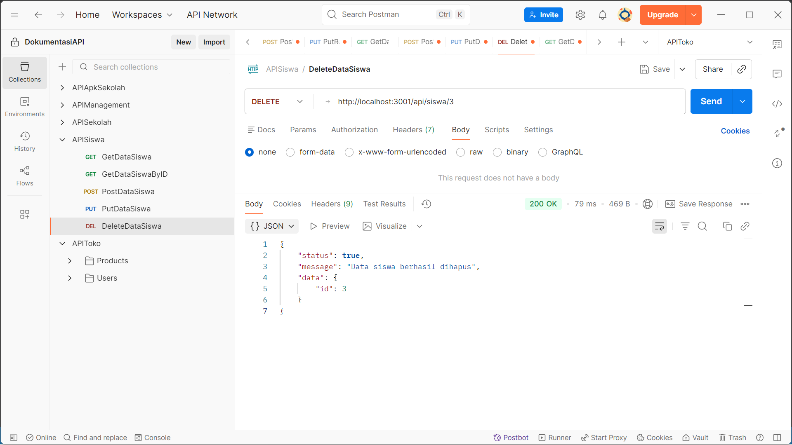

Screenshot merekam hasil pengujian saat dokumentasi dibuat. ID dan isi database dapat berubah.

## Checklist Pengujian

Tandai setelah pengujian dilakukan pada versi terbaru.

- [ ] Login akun Aktif berhasil.
- [ ] Password salah ditolak.
- [ ] Akun Tidak Aktif tidak dapat login.
- [ ] Dashboard menampilkan nama akun yang login.
- [ ] Daftar pengguna tampil.
- [ ] Tambah pengguna berhasil.
- [ ] Edit pengguna berhasil.
- [ ] Password lama tetap digunakan jika kolom password edit dikosongkan.
- [ ] Hapus pengguna berhasil.
- [ ] Akun yang sedang digunakan tidak dapat dihapus atau dinonaktifkan.
- [ ] Search dan filter pengguna berfungsi.
- [ ] Daftar siswa tampil.
- [ ] Tambah siswa berhasil.
- [ ] Edit siswa berhasil.
- [ ] Hapus siswa berhasil.
- [ ] Dropdown kelas dan jurusan berfungsi.
- [ ] Search dan filter kelas berfungsi.
- [ ] Tombol Batal tidak menyimpan perubahan.
- [ ] Logout kembali ke halaman login.
- [ ] APK dapat mengakses backend melalui jaringan lokal.

## Penanganan Kendala

| Kendala | Pemeriksaan |
|---|---|
| `No pubspec.yaml file found` | Jalankan Flutter dari folder yang memiliki pubspec.yaml |
| `ECONNREFUSED` pada port 3306 | Pastikan MySQL aktif dan port sesuai |
| `405 Method Not Allowed` | Periksa method request dan fungsi pada route.ts |
| `401 Unauthorized` | Periksa akun, status, atau login kembali |
| `500 Internal Server Error` | Baca detail error di terminal backend |
| Backend tidak dapat dihubungi | Periksa alamat API, port, dan proses server |
| HP tidak dapat mengakses API | Periksa IP laptop, jaringan, dan firewall |
| Perubahan tampilan belum terlihat | Simpan kode dan lakukan hot restart |
| Screenshot README tidak muncul | Periksa lokasi, nama file, dan huruf besar/kecilnya |

## Pengembangan Selanjutnya

- Melengkapi pemeriksaan token pada seluruh endpoint siswa.
- Menambahkan status kelulusan siswa.
- Menyediakan paket SQL lengkap untuk instalasi database dari awal.
- Memperbarui collection Postman untuk login dan CRUD pengguna.
- Hosting backend dan database agar dapat diakses di luar jaringan lokal.

## Catatan Repository

- `.env.local` tidak disertakan.
- Folder `node_modules`, `.next`, dan hasil build tidak disertakan.
- Dependensi perlu dipasang setelah clone.
- Backend digunakan dari folder `backend-siswa` di dalam repository ini.